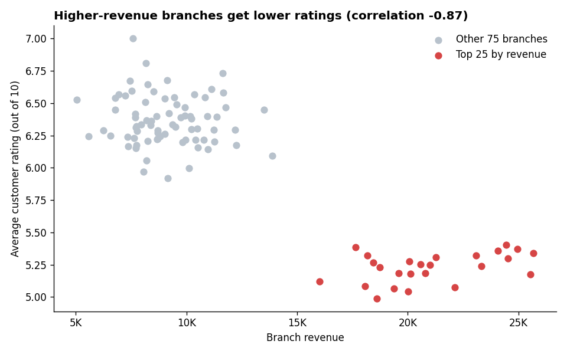
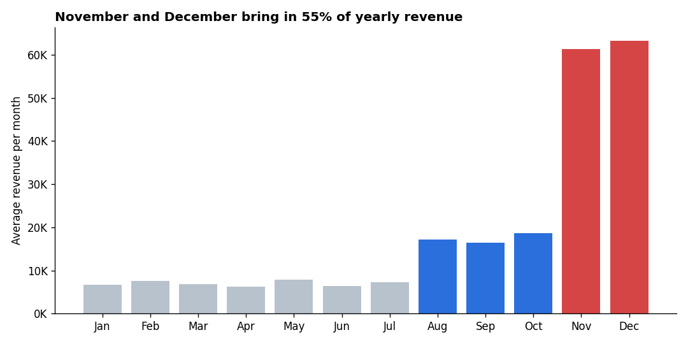
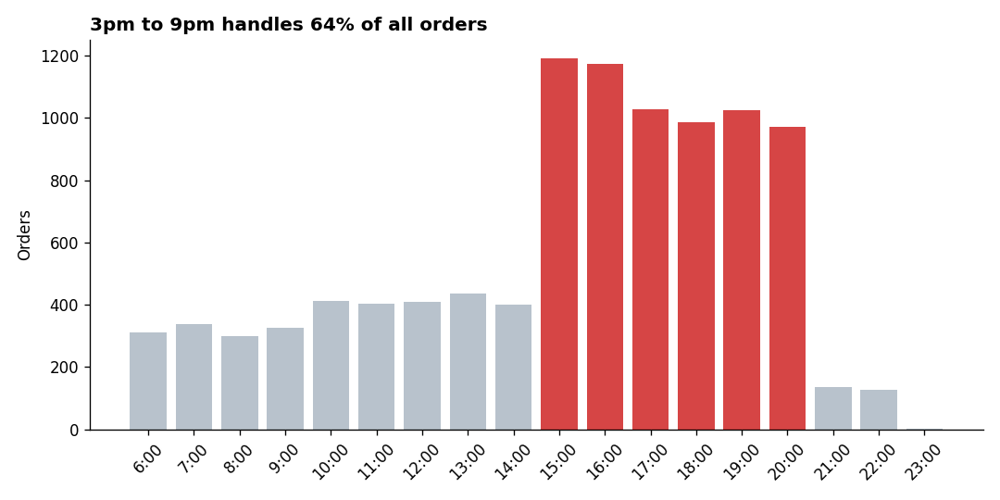
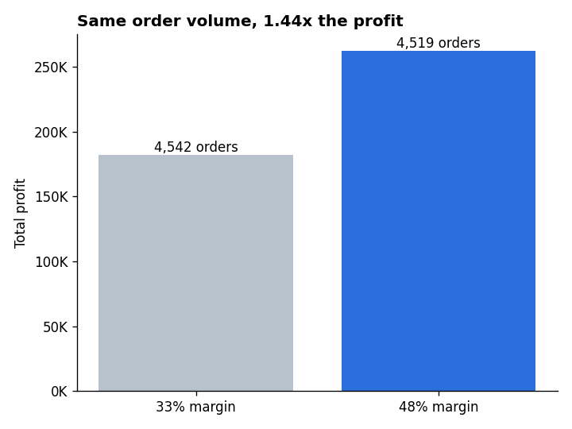
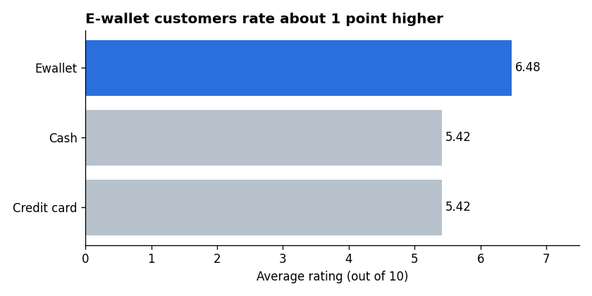

# Walmart Sales Analysis (Python + PostgreSQL)

An end-to-end analysis of 10,051 Walmart transactions across 100 branches in 98 cities (2019 to 2023). The raw CSV is cleaned and enriched in Python, loaded into PostgreSQL, and analyzed with 24 SQL queries. The results become five charts and a set of business recommendations.

## Key findings

| # | Finding | Evidence |
|---|---|---|
| 1 | **The busiest branches have the unhappiest customers.** The 25 highest-revenue branches are exactly the 25 lowest-rated ones. | Branch revenue vs rating correlation: **-0.87**. Top-quartile average rating 5.23, against about 6.35 for the rest |
| 2 | **Margin, not volume, drives profit.** Branches at a 48% margin earn 1.44x the profit of 33% branches on the same order volume. | 4,519 vs 4,542 orders; 262K vs 182K profit |
| 3 | **The holiday season dominates.** November and December bring in 55% of a full year's revenue. | Full years 2020 to 2023 |
| 4 | **Demand peaks late in the day.** 3pm to 9pm handles 64% of all orders. | Orders roughly triple at 3pm |
| 5 | **E-wallet users are happier.** They rate about 1 point higher than card or cash users. | 6.48 vs 5.42 average rating |
| 6 | **Branch growth is polarized.** Revenue grew 6.8% in 2023, yet 42 of 100 branches shrank. | 5 branches fell by more than 50% |

## Recommendations

1. **Add staff and checkout capacity at the 25 highest-revenue branches.** They earn 43.5% of revenue and have the lowest ratings, so poor service puts the most revenue at risk.
2. **Review pricing and supplier costs at the 41 branches on a 33% margin.** Moving them closer to 48% is the biggest profit lever in the data.
3. **Ramp up inventory and seasonal hiring from August** to prepare for the November and December peak.
4. **Schedule the shift change for 3pm**, and test morning promotions to spread demand.
5. **Encourage e-wallet payments** with offers, since e-wallet users report higher satisfaction.
6. **Run a root-cause review of the 5 fastest-declining branches** (WALM045, WALM047, WALM098, WALM033, WALM081), and compare them with the fastest-growing ones.

## Tools

- **Python** (Pandas, SQLAlchemy, Matplotlib) in Google Colab, for cleaning, feature engineering and charts
- **PostgreSQL 17 and pgAdmin 4**, for storage and SQL analysis
- **SQL techniques:** CTEs, window functions (`RANK`, `NTILE`, `SUM() OVER`), `FILTER`, `CASE`, `CORR`

## Dataset

Source: [Kaggle Walmart sales dataset](https://www.kaggle.com/). The raw file has 10,051 rows and 11 columns: invoice_id, branch, city, category, unit_price, quantity, date, time, payment_method, rating and profit_margin.

## Approach

### 1. Cleaning (Python)
- Removed 51 duplicate rows and 31 rows with missing price or quantity, leaving 9,969 clean rows
- Stripped `$` from `unit_price` and converted it to a number

### 2. Feature engineering (Python)
| New column | Logic |
|---|---|
| `total` | unit_price × quantity |
| `profit` | total × profit_margin |
| `year`, `month_name`, `day_name` | Extracted from date |
| `hour` | Extracted from time |
| `shift` | Morning (before 12), Afternoon (12 to 5pm), Evening (6pm onward) |

### 3. Loading (PostgreSQL)
Created a typed `walmart` table and imported the enriched CSV with pgAdmin.

### 4. Analysis (SQL)
24 queries in six sections: business snapshot, product, time patterns, payments, branch performance and customer satisfaction. See [`sql/walmart_analysis.sql`](sql/walmart_analysis.sql). Every query has its result and insight written as a comment underneath.

### 5. Visualization (Python)

| | |
|---|---|
|  |  |
|  |  |

## Repository structure

walmart-sales-analysis/
├── data/
│   ├── Walmart.csv             
│   ├── walmart_clean.csv       
│   └── walmart_enriched.csv    
├── notebooks/
│   └── walmart_cleaning_and_charts.ipynb
├── sql/
│   └── walmart_analysis.sql
├── images/
│   └── (5 chart PNGs)
└── README.md

